# AWS CI/CD practice: EdTech event delivery

This lab deploys an SNS topic connected to an SQS queue, the first link in the
event pipeline described by the existing EdTech Data Platform repository. That
project's event generator emits student activity events with `version`,
`changeType`, `eventInfo`, and `payload` fields. The deployment smoke test
publishes an `ActivityCompleted` event in that shape. SQS holds the event until
a worker is ready to consume it.

## How the pieces fit together

This diagram shows both the software delivery path and the small AWS event path
that the lab deploys:

```mermaid
flowchart LR
    Edit["Edit CloudFormation template"] --> PR["Open pull request"]
    PR --> CI["GitHub Actions: lint and preview"]
    CI --> Review["Review and merge to main"]
    Review --> Deploy["GitHub Actions: deploy"]
    Deploy --> OIDC["GitHub OIDC: short-lived AWS credentials"]
    OIDC --> DeployRole["AWS deploy role"]
    DeployRole --> CFN["CloudFormation uses execution role"]
    CFN --> Topic["SNS topic"]
    Topic --> Queue["SQS queue"]
    Deploy --> Test["Smoke test publishes and checks an event"]
    Test --> Topic
    Queue -. "event received" .-> Test
```



The longer Lexia event pipeline can later continue from SQS through EventBridge
Pipes, Firehose, and S3. This first exercise stops at SQS so the deployment
steps stay small enough to inspect.

## Why these tools?

### Why GitHub Actions?

GitHub Actions runs automation next to the code in this repository. The
workflow in `.github/workflows/demo-stack.yml` is a set of repeatable steps:

- On a pull request, **CI (continuous integration)** lints the templates and,
  for a branch in this repository, asks AWS to preview changes. This catches
  mistakes before they are merged. A fork can run lint, but does not get AWS
  access.
- After a change reaches `main`, **CD (continuous deployment)** deploys the
  stack and sends a test event through SNS to SQS. That proves the AWS resources
  work together, not only that the YAML is valid. If you configure a required
  reviewer for the `demo-deploy` environment, GitHub pauses the deployment for
  approval first.

GitHub uses AWS OIDC to request short-lived credentials for each run. This
avoids saving long-lived AWS access keys in GitHub. Separate plan, deploy, and
CloudFormation execution roles limit which actions each part can perform.

### Why CloudFormation?

CloudFormation is AWS's infrastructure-as-code service. The YAML template
describes the SNS topic, SQS queue, permissions, and subscription that make up
the demo. CloudFormation creates or updates those resources as one named
**stack**. Keeping the description in Git means changes can be reviewed,
versioned, and repeated without manually rebuilding resources in the console.

For an existing stack, the pull request workflow creates a temporary **change
set**. It lists the AWS resource actions CloudFormation plans to take, including
whether a resource may be replaced. The workflow displays and then deletes this
preview; it does not apply it. Deployment happens after a change is merged to
`main`.

## What is in this folder

| File | Job |
| --- | --- |
| `infra/demo/sns-sqs-demo.yml` | Declares the topic, queue, queue policy, subscription, and output values. |
| `infra/demo/bootstrap-github-roles.yml` | One-time setup of the GitHub OIDC provider and three IAM roles. |
| `.github/workflows/demo-stack.yml` | GitHub Actions CI and CD jobs. |

The **plan role** can validate and preview this stack. The **deploy role** can
apply it and perform the smoke test. The **CloudFormation execution role** has
permissions to create the demo SNS/SQS resources. GitHub gets short-lived AWS
credentials through OIDC; no AWS access key is stored in GitHub.

## Prerequisites

Before running the lab, make sure you have:

1. **A GitHub account with access to this repository.** GitHub Actions must be
   enabled. The workflow expects the contents of this `demo_cicd` directory at
   the repository root, where `.github` and `infra` live. This lab is already
   pushed to [visuvishwa99/aws_cicd](https://github.com/visuvishwa99/aws_cicd).
2. **An AWS account and permission to create IAM roles and an OIDC provider,
   CloudFormation stacks, SNS topics, and SQS queues.** The bootstrap step needs
   IAM permissions; the deployed stack uses SNS and SQS. If you cannot create
   IAM roles, ask an account administrator to perform the one-time bootstrap.
3. **AWS CLI v2 and Git installed locally.** Configure the AWS CLI with a
   profile, AWS IAM Identity Center (SSO), or another supported login method.
   Do not put AWS access keys in the repository.
4. **PowerShell** for the commands below. The workflow itself runs on GitHub's
   hosted Linux runner, so you do not need Linux on your computer.
5. **A region to use consistently.** The existing lab is configured for
   `us-east-1`. AWS resources can incur charges, so review current pricing and
   remove the stacks when finished.

If you do not already have the lab on your computer, clone it and enter the
repository folder:

```powershell
git clone https://github.com/visuvishwa99/aws_cicd.git
Set-Location aws_cicd
```

These checks help confirm that Git, the AWS CLI, and your AWS login are ready.
Run them in PowerShell from the repository root (the directory that contains
`.github` and `infra`):

```powershell
$Region = 'us-east-1'
git --version
aws --version
aws sts get-caller-identity
aws configure list
aws cloudformation validate-template --template-body file://infra/demo/bootstrap-github-roles.yml --region $Region
aws cloudformation validate-template --template-body file://infra/demo/sns-sqs-demo.yml --region $Region
```

`get-caller-identity` shows which AWS account and identity your CLI will use.
Check that the account is the one where you intend to create resources. The
two `validate-template` commands check that AWS can parse the templates; they
do not create anything. The GitHub Actions workflow installs `cfn-lint` for its
own checks, so installing it locally is optional.
If you use a named AWS CLI profile, select it first with
`$env:AWS_PROFILE = 'your-profile-name'` so the checks run against the intended
account.

The AWS and GitHub setup for this repository has already been completed. The
bootstrap and GitHub configuration steps below explain how it was set up and
are needed if you repeat the lab in a different repository or AWS account.

## 1. Bootstrap AWS access once

Check whether your account already has GitHub's OIDC provider. IAM providers
are account-wide, so create only one for `token.actions.githubusercontent.com`:

```powershell
aws iam list-open-id-connect-providers --output table
```

If it exists, pass its ARN as an additional parameter in the command below:
`ExistingGitHubOidcProviderArn=arn:aws:iam::ACCOUNT_ID:oidc-provider/token.actions.githubusercontent.com`.
Otherwise, the bootstrap stack creates it. Replace `OWNER/REPO` with the exact
GitHub repository name. Repositories created after 2026-07-15 use immutable
OIDC subjects, so also pass `GitHubOidcSubjectPrefix=repo:OWNER@OWNER_ID/REPO@REPO_ID`.
Find the numeric owner and repository IDs in the repository's GitHub API record.
For this lab, the prefix is
`repo:visuvishwa99@136651017/aws_cicd@1426014114`.

```powershell
aws cloudformation deploy `
  --stack-name learn-sns-sqs-bootstrap `
  --template-file infra/demo/bootstrap-github-roles.yml `
  --parameter-overrides GitHubRepository=OWNER/REPO GitHubOidcSubjectPrefix=repo:OWNER@OWNER_ID/REPO@REPO_ID `
  --capabilities CAPABILITY_IAM `
  --region $Region

aws cloudformation describe-stacks `
  --stack-name learn-sns-sqs-bootstrap `
  --query 'Stacks[0].Outputs' `
  --output table `
  --region $Region
```

This is intentionally a manual bootstrap: the pipeline cannot grant itself
the IAM permissions needed to run. If the OIDC provider already exists, add
`ExistingGitHubOidcProviderArn=...` to `--parameter-overrides` above.

## 2. Configure GitHub

In **Settings → Secrets and variables → Actions → Variables**, create:

| Variable | Value |
| --- | --- |
| `AWS_REGION` | The region used for bootstrap. |
| `DEMO_PLAN_ROLE_ARN` | `PlanRoleArn` output. |
| `DEMO_DEPLOY_ROLE_ARN` | `DeployRoleArn` output. |
| `DEMO_CFN_EXEC_ROLE_ARN` | `ExecRoleArn` output. |

Create a GitHub environment named **`demo-deploy`**. Set its deployment branch
rule to **`main`**. You may add a required reviewer if you want a human pause
between CI and deployment. The IAM deploy role trusts this environment name,
so the spelling must match. The plan job uses the PR identity. Use a PR branch
in the same repository for the AWS preview; fork PRs run lint only.

For this repository, these settings already point to the `learn-sns-sqs-bootstrap`
stack in account `191399301049`, region `us-east-1`. The repository variables
contain only the region and IAM role ARNs; they do not contain AWS access keys.

## 3. Run the lab

1. The initial SNS-to-SQS stack is already deployed. To see the full CI/CD
   path now, open **Actions → SNS/SQS demo stack → Run workflow** on `main`.
   Watch **lint**, **deploy**, and the **smoke test**. The workflow publishes a
   uniquely marked activity event, receives it from SQS, then removes it.
2. Open a PR that changes `infra/demo/sns-sqs-demo.yml`. For a harmless first
   edit, change the template `Description`. Watch **lint**, then **plan** in
   the Actions run. The plan job creates a change set for the deployed stack;
   inspect its proposed action before merging.
3. Merge the PR to `main`. Watch **lint**, **deploy**, and the **smoke test**.
   In AWS CloudFormation, inspect `learn-sns-sqs` and its **Resources** and
   **Outputs** tabs. No deployment happens from a PR.
4. Create a second PR. Change `MessageRetentionPeriod` in the queue from
   `345600` (4 days) to `172800` (2 days). The PR change set should show a
   queue **Modify** action. Read the `Replacement` column before merging.
5. Merge and verify the smoke test passes again. Check the queue in the SQS
   console or inspect the stack events to connect each pipeline step to an
   AWS action.

You can also run **Actions → SNS/SQS demo stack → Run workflow** on `main` to
redeploy without changing the template. An empty change set is a valid no-op.

## What to inspect when something fails

| Failure | First place to look |
| --- | --- |
| `cfn-lint` | Template path and resource/property name in the lint output. |
| `AssumeRoleWithWebIdentity` | GitHub repo name, environment name, branch rule, OIDC provider, and role ARN. |
| Change set | The plan job's `StatusReason` and CloudFormation change sets. |
| Deploy | CloudFormation **Events** for the first failed resource. |
| Smoke test | Stack outputs, SNS subscription, SQS queue policy, and message delivery. |

The first AWS preview deliberately skips a change set until the demo stack
exists. If an older attempt left `learn-sns-sqs` in `REVIEW_IN_PROGRESS`, remove
that empty stack in CloudFormation before retrying. Do not remove a running
stack just to fix a preview.

## Clean up

After the exercise, delete the demo stack first, then the bootstrap stack:

```powershell
aws cloudformation delete-stack --stack-name learn-sns-sqs --region $Region
aws cloudformation wait stack-delete-complete --stack-name learn-sns-sqs --region $Region
aws cloudformation delete-stack --stack-name learn-sns-sqs-bootstrap --region $Region
aws cloudformation wait stack-delete-complete --stack-name learn-sns-sqs-bootstrap --region $Region
```

The bootstrap stack deletes the GitHub OIDC provider only if it created that
provider. If you want to keep practising, leave the bootstrap stack in place
and delete only the demo stack.

## Next Lexia exercises

Once this flow is familiar, add a dead-letter queue for failed messages, then
a small Lambda consumer that writes a processing result. Keep the same rhythm:
template change → PR checks and preview → merge → deployment → end-to-end
smoke test. Each new service makes the CI/CD responsibilities clearer.

## Reference docs

- [CloudFormation change sets](https://docs.aws.amazon.com/AWSCloudFormation/latest/UserGuide/using-cfn-updating-stacks-changesets.html)
- [GitHub OIDC claims](https://docs.github.com/en/actions/reference/security/oidc)
- [AWS credentials action](https://github.com/aws-actions/configure-aws-credentials)
